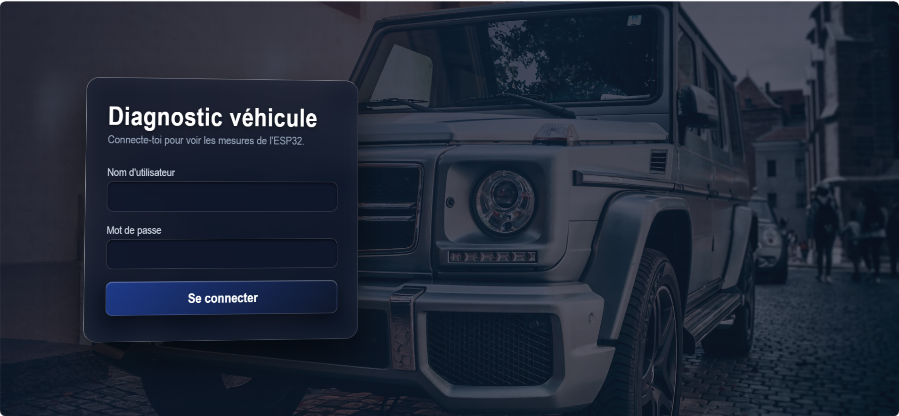
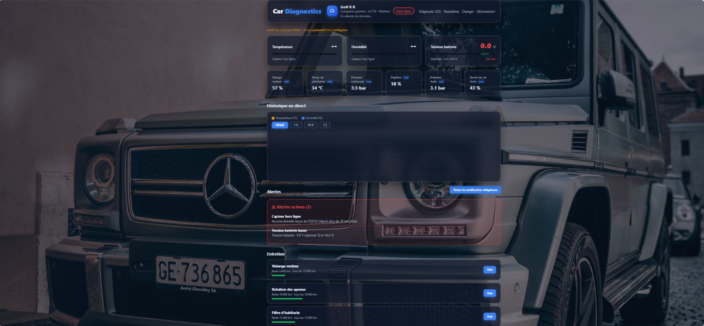
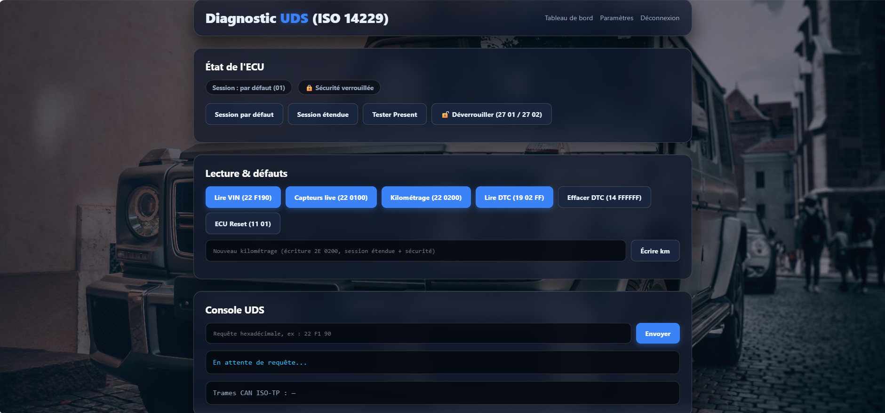

# 🚗 CarDiagnostics-Dashboard

> **Prototype de tableau de bord de diagnostic automobile connecté (ESP32, Flask, UDS ISO 14229)**  
> *Développé par Youssef El Harmouch dans le cadre du Master 2 en Systèmes Embarqués et Robotique (FST Al Hoceima).*

---

## 📸 Aperçu Visuel du Projet

### 1. Prototype Hardware & Notifications Mobile Push


### 2. Écran de Connexion Sécurisé


### 3. Suivi Synthétique du Véhicule


### 4. Tableau de Bord Telemetry & Graphiques Temps Réel


### 5. Console de Diagnostic UDS


---

## 📌 Overview
This project is a real-time car diagnostics and telematics dashboard developed to monitor vehicle environmental conditions, battery status, and process automotive diagnostic services. It uses an **ESP32** microcontroller to acquire sensor data (temperature and humidity via DHT11, along with battery voltage) and transmits it to a **Python Flask** backend over HTTP POST requests. 

The web dashboard features secure user authentication, real-time gauges, historical charts, mobile push notifications via **Ntfy**, and a dedicated console emulating standard **ISO 14229 Unified Diagnostic Services (UDS)**.

---

## 🛠️ Requirements

### Hardware
- **ESP32** development board
- **DHT11** temperature and humidity sensor
- **Voltage Divider Network** (for vehicle battery monitoring)
- **4.7kΩ to 10kΩ pull-up resistor** (for DHT11 DATA line)
- **Breadboard & Jumper Wires**
- **USB Cable** for ESP32 power & programming

### Software
- **Arduino IDE** (with ESP32 board support)
- **Python 3.x**
- **Flask** (`pip install flask`)
- **Flask-CORS** (`pip install flask-cors`)
- **Requests** (`pip install requests`)
- **SQLite3**

---

## ⚙️ Setup Instructions

### 1. ESP32 Setup
1. **Install Arduino IDE:**
   - Download and install the Arduino IDE from [arduino.cc](https://www.arduino.cc/).
   - Add ESP32 board support:
     - Go to **File > Preferences**, add `https://dl.espressif.com/dl/package_esp32_index.json` to **Additional Boards Manager URLs**.
     - Go to **Tools > Board > Boards Manager**, search for **ESP32**, and install the `esp32` package.
   - Install the required libraries:
     - Go to **Sketch > Include Library > Manage Libraries**, search for **DHT sensor library** by Adafruit, and install it.

2. **Connect the Hardware:**
   - **VCC (DHT11)** → 3.3V / 5V (ESP32)
   - **GND (DHT11)** → GND (ESP32)
   - **DATA (DHT11)** → GPIO 4 (ESP32)
   - Add a **4.7kΩ to 10kΩ pull-up resistor** between DATA and VCC.
   - **Battery Sensing Analog Pin** → GPIO 34 (via resistor divider).

3. **Upload the ESP32 Code:**
   - Open `esp32_car_monitor.ino` in the Arduino IDE.
   - Update the Wi-Fi credentials and server endpoint:
     ```cpp
     const char* ssid = "YOUR_WIFI_SSID";
     const char* password = "YOUR_WIFI_PASSWORD";
     const char* serverName = "[http://192.168.1.](http://192.168.1.)X:5000/api/update";
     ```
   - Go to **Tools > Board**, select **ESP32 Dev Module**.
   - Select the correct COM port under **Tools > Port**.
   - Click the **Upload** button.

---

### 2. Flask Server Setup

1. **Set Up Python Environment:**
   - Install Python 3.x on your system.
   - Clone the repository and navigate to the project directory:
     ```bash
     git clone [https://github.com/youssefelharmouch11-bot/Car-Diagnostics-Dashboard.git](https://github.com/youssefelharmouch11-bot/Car-Diagnostics-Dashboard.git)
     cd Car-Diagnostics-Dashboard
     ```
   - Install dependencies:
     ```bash
     pip install flask flask-cors requests
     ```

2. **Run the Flask Server:**
   - Launch the application:
     ```bash
     python server.py
     ```
   - The server will run locally at `http://127.0.0.1:5000` and on your local IP address (e.g., `http://192.168.1.X:5000`).

---

### 3. Access the Dashboard
1. Open your web browser and navigate to `http://localhost:5000` or your local IP.
2. Log in with your credentials to access the telemetry and diagnostic interface.
3. View real-time temperature, humidity, battery voltage, and test UDS diagnostic requests (`19 02 FF`, `22 F1 90`, etc.).

---

## 🧠 Principe du Protocole UDS (ISO 14229)

Le protocole **UDS (Unified Diagnostic Services)**, normalisé par l'**ISO 14229**, est le standard international utilisé dans l'industrie automobile pour le diagnostic électronique des calculateurs (ECU).

### 🔄 Modèle Client-Serveur
Le fonctionnement repose sur une architecture **Client-Serveur** :
- **Le Client (Tester) :** L'outil de diagnostic ou l'interface web qui envoie des requêtes.
- **Le Serveur (ECU / ESP32) :** Le calculateur embarqué qui traite les requêtes, renvoie les données ou effectue les actions demandées.

### 🛠️ Services UDS Implémentés dans ce Projet

| SID | Service UDS | Description & Rôle dans le Projet | Exemple de Trame |
| :---: | :--- | :--- | :--- |
| **`0x10`** | **DiagnosticSessionControl** | Commutation entre session par défaut, étendue (*Extended*) et de programmation. | Requête : `10 03` <br> Réponse : `50 03 ...` |
| **`0x27`** | **SecurityAccess** | Déverrouillage des fonctions sécurisées via échange de clé/graine (*Seed & Key*). | Requête : `27 01` <br> Réponse : `67 01 [Seed]` |
| **`0x19`** | **ReadDTCInformation** | Lecture des codes défauts (*Diagnostic Trouble Codes* - DTC) enregistrés. | Requête : `19 02 FF` <br> Réponse : `59 02 09 ...` |
| **`0x22`** | **ReadDataByIdentifier** | Lecture des données temps réel identifiées par un DID (VIN, tension batterie). | Requête : `22 F1 90` *(Read VIN)* <br> Réponse : `62 F1 90 [VIN]` |
| **`0x14`** | **ClearDiagnosticInformation** | Effacement des codes défauts (DTC) enregistrés dans le système. | Requête : `14 FF FF FF` <br> Réponse : `54` |

---

## 📜 License
This project is licensed under the **MIT License** - see the [LICENSE](LICENSE) file for details.

---

<p align="center">
  <b>Développé par Youssef El Harmouch</b><br>
  <i>Étudiant Ingénieur en Systèmes Embarqués et Robotique</i>
</p>
