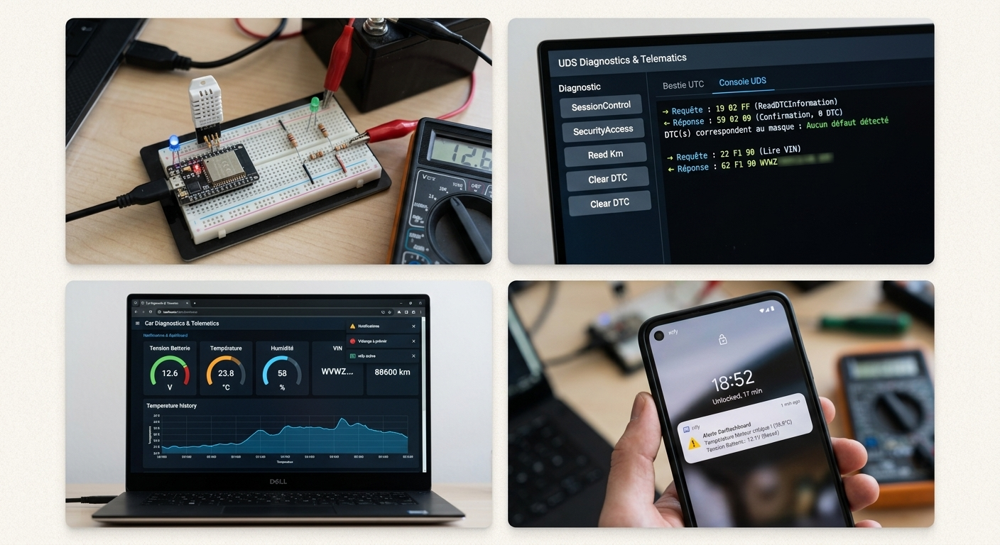

# 🚗 CarDiagnostics-Dashboard

> Prototype de tableau de bord de diagnostic automobile connecté (ESP32, Flask, UDS ISO 14229). Développé dans le cadre du Master en Systèmes Embarqués et Robotique.

---

## 📌 Aperçu du Projet
Ce projet consiste à concevoir et prototyper un système embarqué intelligent pour le suivi de paramètres physiques et électriques (température, humidité, tension de batterie), combinant la technologie IoT et les bases du diagnostic automobile (UDS).

## 🚀 Fonctionnalités Clés
- **ESP32 & DHT11 :** Collecte des données environnementales et transmission via HTTP POST vers un serveur Flask.
- **Serveur Flask :** Traitement des données et gestion de l'interface web de supervision.
- **Tableau de Bord Web :** Interface interactive et sécurisée pour la visualisation en temps réel.
- **Diagnostics UDS :** Simulation des services de diagnostic standardisés (ISO 14229).

## 🛠️ Technologies & Outils
* **Hardware:** ESP32, Capteur DHT11
* **Langages:** C/C++, Python (Flask), HTML, CSS, JavaScript
* **Normes & Protocoles:** Wi-Fi, HTTP, UDS (ISO 14229)
* **Outils:** Arduino IDE, VS Code

## ⚙️ Étapes de Réalisation
1. **Analyse & Conception :** Modélisation de l'architecture du système embarqué et des flux de données.
2. **Développement Embarqué :** Programmation de l'ESP32 en C/C++ pour la lecture des capteurs et la communication sans fil.
3. **Mise en Place du Backend :** Développement du serveur Flask pour la réception et le traitement des trames.
4. **Interface Web & Tests :** Création du dashboard interactif et validation des services de diagnostic.

## 📊 Résultats Obtenus
* Remontée fiable et en temps réel des données capteurs et de la tension batterie.
* Interface de supervision opérationnelle et ergonomique.
* Validation de la chaîne complète IoT de bout en bout.

---

*Développé par Youssef El Harmouch*
